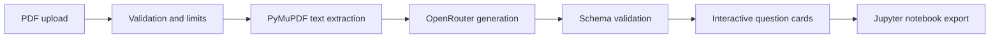

# PDF Question Cards

A full-stack study tool that turns computer-science lecture PDFs into interactive
theory and coding questions. Generated questions can be reviewed in the React
interface or exported as a Jupyter notebook.

## How It Works



The browser sends the selected PDF to a FastAPI endpoint. The backend validates
the file type and size, extracts bounded text, asks the configured model for a
strict JSON response, and normalises the response before returning it to the
React interface. Provider-controlled IDs and unexpected fields are discarded.

## Features

- PDF text extraction with file-size, page-count, and text-length limits
- AI-generated theory and Python coding questions
- Interactive answer cards
- Jupyter notebook export
- Backend rate limiting and provider-response validation
- Automated backend tests, frontend linting, and production builds

## Tech Stack

- **Frontend:** React, TypeScript, and Vite
- **Backend:** FastAPI, PyMuPDF, HTTPX, and nbformat
- **Question generation:** OpenRouter

## Engineering Decisions

- **Server-side provider access:** the OpenRouter credential stays in the
  backend environment and is never exposed to the browser.
- **Bounded processing:** upload size, page count, extracted text, generated
  item count, and notebook export size are capped before expensive work.
- **Validated model output:** generated data is treated as untrusted input and
  converted into a small allow-listed response shape.
- **Safe failure behaviour:** provider failures return generic messages without
  leaking upstream responses or credentials.
- **Portable study output:** generated questions remain usable outside the web
  interface through standards-based Jupyter notebook export.

## Local Setup

Requirements: Python 3.12+, Node.js 22+, and an OpenRouter API key.

```bash
python -m venv .venv
source .venv/bin/activate
pip install -r requirements-dev.txt
cp .env.example .env
```

Add your own values to the ignored root `.env` file:

```dotenv
OPENROUTER_API_KEY=your_key_here
OPENROUTER_MODEL=your_model_id
FRONTEND_ORIGINS=http://localhost:5173
```

Start the backend from the repository root:

```bash
uvicorn backend.main:app --reload --port 8000
```

In a second terminal:

```bash
cd frontend
npm ci
npm run dev
```

Open [http://localhost:5173](http://localhost:5173).

## Validation

```bash
python -m pytest
cd frontend
npm run lint
npm run build
```

GitHub Actions runs these checks for every push and pull request to `main`.

## Current Scope

This is a portfolio and local-development application rather than a hosted
multi-user service. A public deployment should add persistent distributed rate
limiting, authentication where appropriate, provider-side spending limits, and
production monitoring.

## Security Notes

- Never commit a populated `.env` file. The example contains names only.
- If a credential is ever committed, revoke it immediately. Removing it from the
  current branch does not remove it from Git history.
- Question generation is limited to five requests per client per minute and PDFs
  are limited to 10 MB, 100 pages, and 30,000 extracted characters. For a public
  deployment, also configure provider-side spend limits and a durable,
  shared rate limiter.
- Provider errors and malformed model output are converted to generic API errors
  rather than returned to the browser.

## License

Released under the [MIT License](LICENSE).
